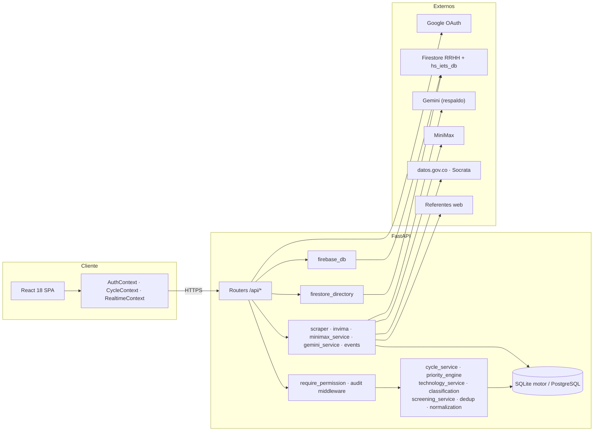

# Sistema de Escaneo de Horizonte del IETS

Plataforma web para el **escaneo de horizonte (horizon scanning)** del **Instituto de
Evaluación Tecnológica en Salud (IETS)** de Colombia: identificación temprana de
tecnologías sanitarias emergentes, vigilancia automatizada de referentes internacionales,
priorización según la matriz oficial del Manual Metodológico, caracterización técnica,
diseminación de informes asistida por IA y colaboración del equipo, todo bajo una
bitácora de auditoría inmutable.

Inspirado en el modelo operativo del
[NIHR Innovation Observatory](https://io.nihr.ac.uk/) y construido sobre la línea gráfica
corporativa definida en [`linea-grafica-y-ux-ui.md`](linea-grafica-y-ux-ui.md).

**Versión:** 7.0.0 · **Stack:** FastAPI + React 18 · SQLite (Render actual) o PostgreSQL 15 · Alembic · Docker

> **v7.0 — Producto de producción.** Sobre las fases 0 a 6 del
> [plan de actualización](Plan_Fases_Actualizacion_Plataforma_EH_IETS.md), esta versión
> cierra la fase 0 pendiente y el endurecimiento de la fase 7: acceso con correo y
> contraseña (Google queda opcional), nombres institucionales tomados de Firestore
> cuando el correo coincide, módulo de administración de usuarios, perfil de
> producción, migraciones Alembic, contenedores, CI/CD, vigilancia y barrido
> programados, correo, reCAPTCHA, paquete de diseminación, bandeja de trabajo por
> perfil y tablero de gobernanza con grafo consultable (chat por nodo y vistas
> guardadas). Cada flujo está cubierto por pruebas unitarias, de API y de navegador.
> Despliegue: [`DEPLOY.md`](DEPLOY.md) · Cumplimiento: [`BACKLOG.md`](BACKLOG.md).
>
> **Octubre 2026 — Matriz EH de fuentes.** El inventario se alinea con la matriz
> «Fuentes de información proactiva EH»: **95 fuentes** en seis bloques (nuevo bloque de
> revistas y portales de noticias), nivel de fuente, prioridad, tipos de tecnología,
> ruta de acceso y URLs de entrada editables con listas desplegables. Cada fuente tiene
> su **flujo de escaneo** (recorrido, enlaces, OCR, IA y búsqueda web) y la IA lanza
> **búsquedas `site:` en buscadores** para encontrar documentos que el menú del sitio no
> muestra. Todo se parametriza en *Configuración › Parámetros de fuentes*. Ver
> [Inventario de fuentes y matriz EH](#inventario-de-fuentes-y-matriz-eh).
>
> **Octubre 2026 — Operación en Render y copia local.** MiniMax queda disponible con
> llave embebida (el panel puede sustituirla). El login ya no espera a Firestore ni
> escribe en SQLite si el usuario existe. **La base vive en Firebase** (colección
> `hs_iets_db` del mismo proyecto RRHH): al arrancar se restaura y cada escritura se
> publica. SQLite solo es el motor local. Hace falta `FIREBASE_SERVICE_ACCOUNT_KEY` en
> Render. Cumplimiento RF/RNF:
> [`Comparacion_Requerimientos_Validacion_SI_Escaneo_Horizonte.md`](Comparacion_Requerimientos_Validacion_SI_Escaneo_Horizonte.md).
>
> **20 de octubre de 2026 — Versión final.** Revisión completa con la IA real y cierre
> de lo pendiente:
>
> - **IA (MiniMax-M3)** operativa en chat, vigilancia, OCR, informes, notas y grafo;
>   cuando responde, la IA decide qué enlaces son señales reales.
> - **Conectores** reparados o nuevos: EMA, CTIS, PCORI y Health Canada.
> - **Sonda en verde**: los sitios que bloquean robots se recorren por su RSS oficial
>   o por Google News ([detalle](#sonda-de-salud-y-rutas-de-respaldo)).
> - **Vigilancia programada encendida** con SQLite, sin bloquear el ingreso.
> - **Cruce INVIMA en vivo** con datos.gov.co.
> - **PDF nativo** de expedientes, boletines y fichas públicas.
> - **Tablero estratégico rediseñado** para quien decide
>   ([detalle](#tablero-estratégico)).
> - **Guía rápida** de ocho pantallas que explica perfiles y relevos.
> - **Tooltips** que ya no quedan ocultos detrás de tarjetas o del menú.
> - **Servidores locales y de prueba** que ya no escriben sobre la copia de producción
>   en Firestore.

---

## Índice

- [Conceptos clave](#conceptos-clave)
- [Metodología y módulos](#metodología-y-módulos)
- [El ciclo operativo](#el-ciclo-operativo)
- [Filtrado, desduplicación e INVIMA](#filtrado-desduplicación-e-invima)
- [Matriz oficial de priorización %P](#matriz-oficial-de-priorización-p)
- [Perfiles y permisos](#perfiles-y-permisos)
- [Tablero estratégico](#tablero-estratégico)
- [Acceso, cuentas y seguridad](#acceso-cuentas-y-seguridad)
- [Bitácora de auditoría](#bitácora-de-auditoría)
- [Catálogos y parámetros metodológicos](#catálogos-y-parámetros-metodológicos)
- [Inventario de fuentes y matriz EH](#inventario-de-fuentes-y-matriz-eh)
- [Arquitectura](#arquitectura)
- [Estructura del proyecto](#estructura-del-proyecto)
- [Modelo de datos](#modelo-de-datos)
- [API REST](#api-rest)
- [Puesta en marcha](#puesta-en-marcha)
- [Verificación](#verificación)
- [Configuración](#configuración-backendenv)
- [Migración desde versiones anteriores](#migración-desde-versiones-anteriores)
- [Flujo de uso sugerido](#flujo-de-uso-sugerido)
- [Documentación relacionada](#documentación-relacionada)
- [Comparación con la matriz de validación de requerimientos](Comparacion_Requerimientos_Validacion_SI_Escaneo_Horizonte.md)

---

## Conceptos clave

Cuatro conceptos ordenan todo el sistema. Entenderlos evita la mayor parte de las dudas de operación.

**Señal (`Finding`).** Lo que la vigilancia extrae de un referente: un título, una URL y un texto. Es el registro de captura y no se descarta nunca.

**Tecnología (`Technology`).** La unidad metodológica: un medicamento, un dispositivo, un procedimiento. Persiste entre ciclos con su clúster, su tipología, sus fechas regulatorias y su identidad. Cada señal capturada origina una tecnología.

**Ciclo (`Cycle`).** La ventana de trabajo formal: entre 10 y 16 semanas, máximo tres al año. Tiene su propia máquina de estados y, al cerrarse, congela todo lo que contiene.

**Instancia por ciclo (`CycleTechnology`).** La evaluación de una tecnología *dentro de* un ciclo. Aquí viven el estado, el puntaje y la clasificación. Es lo que permite que una tecnología quede bajo vigilancia en el Ciclo I, se arrastre al Ciclo II y se reevalúe **sin sobrescribir** el registro anterior.

---

## Metodología y módulos

| Fase | Módulo | Ruta | Qué hace |
|---|---|---|---|
| **Operación** | Bandeja de trabajo | `/` | Pendientes del perfil (`my-work`) e indicadores del ciclo; cada tarjeta enlaza a la acción |
| **1. Identificación** | Vigilancia | `/vigilancia` | Conectores API (ClinicalTrials, openFDA, EMA, CTIS, PubMed, PCORI, Health Canada) y HTML con RSS o Google News de respaldo, en cola; vigilancia programada |
| **Canal reactivo** | Postulación pública | `/postular` | Formulario externo con conflicto de interés; entra a moderación, no al catálogo |
| **Canal reactivo** | Postulaciones | `/postulaciones` | Cola de aceptación o rechazo; lo aceptado llega a la bandeja como reactivo |
| **1. Identificación** | Inventario | `/fuentes` | Catálogo D-06 + matriz EH: 95 fuentes con prioridad, nivel de fuente, tipos de tecnología y flujo de escaneo; sonda de salud y cobertura |
| **1. Identificación** | **Bandeja de entrada** | `/bandeja-entrada` | Staging: clasificar señales capturadas y asignarlas por lotes al ciclo |
| **Transversal** | **Ciclos** | `/ciclos` | Crear, transicionar y cerrar ciclos; embudo de conversión |
| **Filtrado** | **Filtrado y depuración** | `/filtrado` | Duplicados difusos, verificación de novedad, cruce INVIMA y Listado Único |
| **2. Priorización** | **Priorización oficial** | `/priorizacion` | Matriz P1–P6, cálculo de %P y clasificación en tres franjas |
| **2. Priorización** | Señales | `/senales` | Cola de cribado por `screening_score`, aún sin calificar |
| **5. Evaluación** | Evaluación temprana | `/evaluacion` | Ficha, informe o Mini-HTA; seis estados editoriales; COI bloqueante; exporta HTML institucional y **PDF** |
| **5. Evaluación** | Revisión por pares | `/revisar/:token` | Portal externo sin cuenta; token JWT de 10 días |
| **4. Diseminación** | Informes de adopción | `/diseminacion` | Recomendaciones para Colombia (IA o manual) |
| **4. Diseminación** | Notas | `/notas` | Anotaciones vinculadas a señales, fuentes e informes |
| **6. Diseminación** | Tablero estratégico | `/dashboards` | Resumen para decidir, embudo con pérdidas, lectura rápida, listas de atención, llegada al mercado, matriz de decisión, clústeres por etapa, avance de expedientes, impacto presupuestal (restringido) y grafo de gobernanza. Ver [Tablero estratégico](#tablero-estratégico) |
| **6. Diseminación** | Ficha pública | `/expedientes` | Buscador y ficha sin autenticación; ficha técnica en **PDF** |
| **6. Diseminación** | Boletines | `/boletines` | Compilación al cierre; aprobación del líder; descarga en **PDF** |
| **6. Diseminación** | Alertas | `/alertas` | Fase III en país y alto riesgo presupuestal |
| **Análisis** | Asistente IA | `/chat` | Chat con contexto del sistema; las consultas por nodo del grafo se guardan aparte |
| **Gobierno** | **Auditoría** | `/auditoria` | Bitácora inmutable con filtros y vida completa de cada entidad |
| **Admin** | Usuarios y perfiles | `/usuarios` | Alta, edición, perfil, contraseña temporal, desbloqueo, activación y baja de cuentas; matriz de permisos |
| **Admin** | Configuración | `/configuracion` | IA, prompts, llaves de fuentes, parámetros de fuentes (listas de la matriz, búsqueda web, carga del Excel), tareas programadas, catálogos, parámetros metodológicos y **copia de la base en este navegador** |

**Guía rápida.** Se abre sola en el primer ingreso y luego con el botón *Guía* de la cabecera. Son ocho pantallas con diagramas: mapa del sistema y perfil de quien entra, las cuatro fases (identificar, priorizar con la escala P1–P6, evaluar y publicar con los estados editoriales), **quién hace qué** (una tarjeta por perfil con las fases en que participa), **cómo se pasan el trabajo** (los relevos del ciclo, de la señal al cierre), las ayudas de la interfaz y tres acciones para empezar según el perfil. Cada fase tiene botones que llevan a la pantalla donde se trabaja.

**Ayudas en pantalla.** Cada término técnico lleva un ícono ⓘ con su explicación. La burbuja se dibuja por encima de toda la página, se voltea si no cabe y nunca queda tapada por una tarjeta, una tabla o el menú lateral (`components/Tooltip.jsx`). Los botones deshabilitados explican por qué al pasar el cursor.

**Rutas heredadas** (redirección automática): `/escaneo → /vigilancia`, `/hallazgos → /senales`, `/recomendaciones → /diseminacion`, `/caracterizacion → /evaluacion`.

> La antigua `/priorizacion` (lista de señales ordenada por heurística) vive ahora en `/senales`.
> La ruta liberada la ocupa la matriz oficial %P.

---

## El ciclo operativo

Todo el trabajo metodológico ocurre dentro de un ciclo. El selector del encabezado indica cuál está activo y contextualiza las vistas de priorización y caracterización.

### Reglas que el sistema hace cumplir

| Regla | Cómo se aplica |
|---|---|
| Máximo 3 ciclos formales por año calendario | Rechazo con HTTP 422 y mensaje explícito al crear el cuarto |
| Ventana de 10 a 16 semanas | Validada al crear y al editar, contra la fecha de boletín o de corte |
| Transiciones de estado predefinidas | Cualquier salto no contemplado responde 409 con las transiciones válidas |
| Solo el superadministrador cierra un ciclo | Permiso `cycle:close`, exclusivo de ese perfil |
| No se cierra con tecnologías en evaluación sin informe | Bloqueo, salvo justificación de cierre registrada en bitácora |
| Al cerrar, los puntajes se congelan | Todo intento posterior de calificar responde 409 |
| Lo que queda bajo vigilancia se arrastra | Nueva instancia en el ciclo destino, con el %P previo visible como referencia |

### Estados

```
En configuración → En filtrado → En priorización → En evaluación → Cerrado / consolidado
        ↑                ↓               ↓                ↓
        └────────────────┘───────────────┘────────────────┘   (retrocesos permitidos)
```

Los estados de la tecnología dentro del ciclo son: `capturada_no_asignada`, `asignada_a_ciclo`, `filtrada_apta_priorizacion`, `excluida`, `priorizada`, `bajo_vigilancia`, `no_priorizada`, `en_evaluacion` y `publicada`.

---

## Filtrado, desduplicación e INVIMA

Entre la asignación al ciclo y la matriz de priorización se interpone `/filtrado`. Su razón de ser es que **calificar una tecnología cuesta seis juicios humanos**: hacerlo sobre un duplicado, o sobre un genérico que nadie considera novedoso, desperdicia el recurso más escaso del proceso.

La pantalla tiene tres pestañas, en el orden en que conviene recorrerlas.

### Duplicados

El hash exacto solo atrapa la misma noticia repetida. La misma tecnología llega de tres referentes con tres nombres distintos, y esa es la que importa.

El barrido compara **nombre comercial, DCI, identificadores NCT y fabricante** con tres algoritmos que fallan de manera diferente:

| Algoritmo | Qué atrapa |
|---|---|
| Levenshtein | Erratas y transliteraciones: `Trastuzumab` frente a `Trastuzumap` |
| Jaro-Winkler | Coincidencia fuerte de prefijo, que es donde vive la raíz del principio activo |
| Token sort | Reordenamientos: `Anticuerpo anti-HER2 Roche` frente a `Roche anticuerpo anti-HER2` |

Tres reglas gobiernan el resultado:

- **Un NCT compartido es prueba, no indicio.** Dos registros que citan el mismo ensayo clínico son el mismo desarrollo, aunque los nombres no se parezcan en nada. La propuesta se marca como decisiva.
- **Un fabricante distinto desmiente la coincidencia de nombre.** Dos anticuerpos anti-HER2 de laboratorios distintos son competidores, no duplicados, y el motor exige una similitud mucho mayor antes de proponerlos.
- **El sistema nunca fusiona solo.** Deja una `MergeProposal` con su puntaje desglosado por algoritmo y espera confirmación. La fusión escribe `merged_into_id`, saca a la absorbida del Listado Único sin borrarla, y queda en la bitácora con actor y momento. Descartar también deja rastro: la próxima corrida no vuelve a proponer el par.

El umbral (`dedup.similarity_threshold`, defecto 85) es un parámetro editable. Bajarlo propone más pares y exige más revisión.

### Novedad y verificación regulatoria

Ninguna tecnología entra a la matriz `%P` sin que alguien declare **por qué es nueva**. La verificación vive por ciclo, no por tecnología: lo que era novedoso en el Ciclo I puede no serlo en el Ciclo II.

Cuatro vías la satisfacen:

| Vía | Cuándo aplica |
|---|---|
| No disponible en el país | Sin registro sanitario vigente en Colombia |
| Nueva indicación | Tecnología ya registrada que se propone para otra condición |
| Nueva forma farmacéutica | Cambio de vía o de presentación con impacto clínico |
| Nueva combinación | Asociación de principios activos ya existentes |

Y dos casos la niegan de forma explícita: **genéricos y biosimilares**, y **modificaciones menores** de presentación o empaque.

La compuerta es dura. `POST /technologies/{id}/cycles/{cid}/qualify` responde **409** si no hay verificación registrada o si la registrada no cumple, con el motivo en el cuerpo de la respuesta. La opción "otra" exige justificación escrita.

### El índice regulatorio vive en casa

La especificación pide que la verificación responda por debajo de 100 ms. Consultar datos.gov.co en cada cruce no lo permite, y la disponibilidad del dato abierto tampoco está garantizada, así que el sistema mantiene **una copia local** en `invima_records`, con las claves de búsqueda ya normalizadas.

Se alimenta por dos rutas:

- **`POST /api/invima/sync`** — descarga incremental desde los conjuntos Socrata de datos.gov.co. El sistema recorre varios conjuntos porque ninguno solo es suficiente, y registra cuáles respondieron y cuáles vinieron vacíos.
- **`POST /api/invima/sync/file`** — carga de un CSV o Excel descargado a mano. Es la ruta de contingencia prevista en el plan, y funciona sin conectividad hacia la fuente.

Cada sincronización queda en `invima_syncs` con su origen, filas ingresadas y resultado. **A los 30 días sin sincronizar, la pantalla muestra una alerta de obsolescencia**, porque un filtro regulatorio desactualizado produce falsos negativos silenciosos: dice que algo no está registrado cuando sí lo está.

**Cruce en vivo.** El registro completo tiene cerca de dos millones de filas y la copia local guarda una parte. Cuando un cruce no encuentra un candidato suficiente en casa, el sistema consulta en paralelo los tres conjuntos de datos.gov.co: CUM `i7cb-raxc` (con principio activo), dispositivos `y4qt-w6tk` y registro general `ui32-p9f2`. Busca por raíces del nombre, así que un DCI en inglés encuentra el registro en español. Lo hallado se guarda en el índice local. La consulta espera como máximo 8 segundos y recuerda durante 6 horas lo que no encontró. Se apaga con `INVIMA_LIVE_LOOKUP=false`, y las pruebas aisladas lo apagan. Las fechas del CUM vienen en formato estadounidense y se interpretan como tales; las fechas de relleno (año 1900 o anterior) se descartan.

### Listado Único por clúster

Lo que sobrevive al filtro se consolida en `GET /api/screening/unique-list/{ciclo}`: agrupado por clúster, con conteos, exportable a CSV y congelado al cerrar el ciclo. Es la vista que se publica y la que alimenta la matriz de priorización.

### Normalización de vocabularios

`POST /api/screening/normalize/{id}` canoniza los códigos antes de compararlos: **ATC** con validación de su estructura jerárquica, **CIE-10** en formato de punto, **MeSH** y la nomenclatura de dispositivos **GMDN/EMDN**. Cuando falta un código, el sistema propone candidatos a partir del clúster asignado, como sugerencia visible que confirma una persona.

---

## Matriz oficial de priorización %P

Seis criterios binarios del Manual Metodológico. **`%P = (suma de puntos / 6) × 100`.**

| Criterio | Pregunta | Quién califica | Pre-llenado |
|:---:|---|---|:---:|
| **P1** | ¿La tecnología es nueva, es decir, no está disponible en el país? | Evaluador técnico | Sí |
| **P2** | ¿La condición es relevante por alta mortalidad, morbilidad o deterioro grave de la calidad de vida? | Evaluador clínico | — |
| **P3** | ¿La condición representa alta carga de enfermedad o impacto financiero sustancial para el SGSSS? | Evaluador clínico | — |
| **P4** | ¿Se anticipa un impacto organizacional importante: cambio de ruta clínica, infraestructura o entrenamiento complejo? | Evaluador clínico *(decisión abierta)* | — |
| **P5** | ¿Ha sido aprobada por EMA o FDA en los últimos 12 meses o menos? | Evaluador técnico | Sí |
| **P6** | ¿Está bajo proceso formal de evaluación regulatoria en agencias de referencia, en 6 meses o menos? | Evaluador técnico | Sí |

### Clasificación

| Puntos | %P | Resultado |
|:---:|:---:|---|
| 4 a 6 | 66,67 a 100 | **Priorizada** |
| 3 | 50,00 | **Bajo vigilancia** — se arrastra al ciclo siguiente |
| 0 a 2 | 0 a 33,33 | **No priorizada** |

### Garantías del motor

- **El `%P` no existe hasta que existen los seis criterios.** Mientras falte uno, la API devuelve `priority_pct: null` y la lista de faltantes; la interfaz no muestra ningún porcentaje.
- **Permisos por campo.** Un evaluador clínico que intente calificar P1, P5 o P6 recibe 403, y el intento queda registrado.
- **Sugerencias, no decisiones.** El pre-llenado de P1, P5 y P6 se calcula desde las fechas de aprobación FDA y EMA, el registro INVIMA y el estado regulatorio, y se presenta con su motivo visible. El evaluador confirma o corrige; nunca se aplica solo.
- **Enunciados versionados.** Las preguntas viven en base de datos con número de versión. Un ajuste del Manual no obliga a desplegar, y cada calificación conserva la versión del enunciado bajo el que se emitió.
- **Umbrales parametrizables.** `priority.points_prioritized` y `priority.points_watch` se editan en caliente.

### Sobre el puntaje anterior

El antiguo `priority_score` (heurística 0–100, umbral 70 %) se renombró a **`screening_score`** y quedó confinado a ordenar la cola de señales aún no calificadas en `/senales`. **Ya no gobierna transiciones de estado ni se presenta como puntaje de priorización.** Las dos escalas no son comparables: los tableros históricos corresponden al modelo anterior.

---

## Perfiles y permisos

Cinco perfiles con permisos declarativos por módulo y, en la matriz de priorización, por criterio.

| Perfil | Alcance |
|---|---|
| **Superadministrador** | Todo: cierre de ciclos, catálogos, usuarios, configuración y bitácora |
| **Evaluador técnico** | Vigilancia, staging, tecnologías, ciclos, filtrado, sincronización de INVIMA e informes; califica **P1, P5 y P6** |
| **Evaluador clínico** | Vigilancia, staging, tecnologías, filtrado e informes; califica **P2, P3 y P4** |
| **Tomador de decisiones** | Consulta y tableros restringidos; puede escribir notas |
| **Revisor por pares** | Consulta y envío de revisiones; el experto externo entra por token, sin cuenta permanente |

A esos cinco se suma el **revisor externo**, que no tiene cuenta: entra con el enlace temporal de su invitación, firma su conflicto de interés, comenta por campo y da su veredicto.

### Cuándo participa cada perfil y cómo se pasan el trabajo

| # | Fase | Quién | Qué hace |
|:-:|---|---|---|
| 1 | Identificar | Técnico y clínico | Capturan señales (vigilancia y postulaciones), las clasifican por clúster y tipología y las asignan al ciclo |
| 2 | Identificar | Técnico | Depura duplicados y cruza con INVIMA; queda el Listado Único |
| 3 | Priorizar | Técnico y clínico | Califican en paralelo: técnico P1, P5 y P6; clínico P2, P3 y P4. Con los seis, el sistema calcula el `%P` |
| 4 | Evaluar | Técnico y clínico | Abren el expediente (ficha, informe o Mini-HTA), lo coeditan y lo envían a revisión interna |
| 5 | Evaluar | Revisor de pares | Comenta; el técnico pasa a revisión externa e invita al experto |
| 6 | Evaluar | Revisor externo | Revisa por enlace; si pide cambios, el expediente vuelve a borrador y los evaluadores corrigen |
| 7 | Publicar | Técnico o superadministrador | Registran el visto bueno del comité técnico y publican (ficha pública, boletín y tablero) |
| 8 | Publicar | Tomador de decisiones | Consulta tablero, alertas y boletín |
| 9 | Cierre | Superadministrador | Cierra el ciclo: los puntajes se congelan y lo que quedó bajo vigilancia pasa al siguiente |

Las transiciones editoriales exigen un permiso concreto (`TRANSITION_PERMISSION` en [`evaluation_service.py`](backend/app/evaluation_service.py)):

- Pasar a revisión interna o volver a borrador: `report:write` (los dos evaluadores).
- Devolver con observaciones: `review:submit` (el revisor de pares, o el externo por su enlace).
- Pasar a revisión externa, registrar el comité y publicar: `cycle:write` (técnico y superadministrador).

La guía rápida muestra esta misma tabla como dos pantallas y resalta los pasos de quien la abre.

La matriz completa de los 20 permisos está en [`BACKLOG.md`](BACKLOG.md#matriz-rbac-de-cinco-perfiles) y su fuente de verdad en [`backend/app/rbac.py`](backend/app/rbac.py).

**Migración automática de roles heredados** al arrancar: `admin → superadmin`, `editor → evaluador_tecnico`, `viewer → tomador_decisiones`. Los perfiles `evaluador_clinico` y `revisor_pares` requieren alta manual desde `/usuarios`.

El frontend no reimplementa la autorización: `GET /api/auth/me` devuelve `permissions` y `rateable_criteria`, y la interfaz se dibuja a partir de esa respuesta.

---

## Tablero estratégico

`/dashboards` resume el ciclo para quien decide (RF17). Todo se calcula con el **recorte** activo: clúster, tipología, etapa alcanzada y llegada al mercado; en *Más filtros*, fase, estado, puntos mínimos y fechas de captura. Los filtros viajan en el enlace, así que se puede compartir un recorte. Casi todo es clicable y filtra el tablero.

| Bloque | Qué responde |
|---|---|
| **Resumen para decidir** | Priorizadas · *Actuar ya* (priorizadas que llegan en ≤ 12 meses) · Llegan en menos de un año (y cuántas ya aprobó FDA/EMA) · Expedientes publicados y en curso · Impacto presupuestal a 3 años (capa restringida) o tecnologías por calificar |
| **Embudo del ciclo** | Capturadas → filtradas → priorizadas → evaluadas → publicadas, con cuántas se quedaron entre una etapa y otra |
| **Lectura rápida** | Frases calculadas: el mayor corte del embudo, el clúster que concentra lo priorizado, priorizadas inminentes, aprobadas sin informe, priorizadas sin expediente y tecnologías sin fecha para estimar su llegada |
| **Requieren atención** | Cuatro listas con enlace: llegan pronto y no están priorizadas, priorizadas sin expediente, aprobadas FDA/EMA sin informe publicado, expedientes con observaciones |
| **¿Cuándo llegan al mercado?** | Columnas por franja de time-to-market (inminente, transición, emergente, lejano, sin dato), divididas por resultado de la priorización |
| **Matriz de decisión** | Cada tecnología según puntos P1–P6 y meses al mercado, en cuadrantes *Actuar ya*, *Preparar*, *Revisar* y *Vigilar* |
| **Clústeres por etapa** | Dónde se acumula el trabajo: sin priorizar, priorizada sin expediente, en evaluación o publicada |
| **Avance de los expedientes** | Fichas, informes y Mini-HTA por estado editorial; muestra el cuello de botella de la revisión |
| **Tipología y fase clínica** | Distribución con porcentaje |
| **Impacto presupuestal** | Mapa de calor por clúster y año, y las 8 tecnologías de mayor impacto a 3 años. Solo con `analytics:restricted` |
| **Tabla, comparadores y grafo** | Tecnologías del recorte (ordenable, con enlace al módulo de cada una), comparadores del SGSSS (restringido) y grafo de gobernanza con chat por nodo |

Un ciclo abierto se calcula en vivo; uno cerrado usa el **datamart** guardado al cierre, que se puede recalcular. El recorte se exporta a CSV o Excel respetando la capa de acceso, y la página se imprime sin menú ni cabecera.

---

## Acceso, cuentas y seguridad

### Cómo se entra

| Vía | Cuándo | Notas |
|---|---|---|
| **Correo y contraseña** | Siempre (vía principal de producción) | Cuentas creadas por el superadministrador en `/usuarios` |
| Google institucional | Solo con `GOOGLE_CLIENT_ID` | Sin la variable, el botón no aparece |
| Acceso de desarrollo | Solo fuera de producción | Se apaga solo con `ENVIRONMENT=production`, aunque `ALLOW_DEV_LOGIN=true`; el intento queda en bitácora |

### Ciclo de vida de una cuenta

1. El superadministrador crea la cuenta en `/usuarios` (o la primera, por consola: `python -m app.cli create-admin --email persona@iets.org.co --name "Nombre"`).
2. El sistema genera una **contraseña temporal** que se muestra **una sola vez**.
3. En el primer ingreso la persona debe cambiarla: hasta hacerlo, la API solo le permite consultar su perfil y cambiar la contraseña.
4. Para retirar a alguien se **desactiva** la cuenta (se cierra su sesión de inmediato y su historia se conserva). Eliminar solo es posible en cuentas que nunca se usaron.

### Nombre visible (directorio Firestore)

El nombre que se muestra en la interfaz **no es el residual de la base local**. Si el correo institucional coincide con un documento de la colección `usuarios` de Firestore (RRHH), se arrastran `nombres` y `apellidos` de ahí. Solo si no hay coincidencia se usa un nombre real ya capturado; los placeholders (`Administrador IETS`, el usuario del correo, etc.) no se muestran.

La coincidencia es por correo en minúsculas. El resultado se cachea dos minutos para no consultar Firestore en cada petición autenticada. Sin credenciales o si el directorio no responde, la sesión sigue; no se inventa un nombre.

### Salvaguardas

- **Contraseñas:** hash `scrypt` con sal (biblioteca estándar); política de 10 caracteres mínimo con letras y números y sin el usuario del correo. El hash nunca sale por la API ni se copia a la bitácora.
- **Fuerza bruta:** bloqueo de la cuenta 15 minutos tras 5 intentos fallidos, más un límite de 30 intentos por IP cada 5 minutos. El mensaje de error es el mismo exista o no la cuenta.
- **Sesiones:** JWT firmado con `typ=session` y versión de credenciales. Cambiar o restablecer la contraseña, o desactivar la cuenta, invalida las sesiones abiertas. El enlace del revisor externo (`typ=review`) no abre sesión interna.
- **Gobierno:** nunca queda el sistema sin un superadministrador activo; nadie se quita su propio perfil ni se desactiva.
- **Producción (`ENVIRONMENT=production`):** el servidor no arranca con la `SECRET_KEY` de ejemplo o corta; se envían `Strict-Transport-Security`, `Content-Security-Policy`, `X-Frame-Options`, `X-Content-Type-Options` y `Referrer-Policy`; las respuestas de la API llevan `Cache-Control: no-store`.
- **Bitácora de acceso:** `auth:login`, `auth:login_failed` (los intentos sin cuenta quedan como `anonimo:<correo>`), `auth:locked`, `auth:unlocked`, `auth:password_changed`, `auth:password_reset`, `auth:dev_login_denied`, `users:delete`.

### Comandos de administración (desde `backend/`)

| Comando | Uso |
|---|---|
| `python -m app.cli create-admin --email X --name "Y"` | Crea o promueve un superadministrador (sin `--password` genera una temporal; `--password -` la pide sin eco) |
| `python -m app.cli reset-password --email X` | Asigna una contraseña temporal |
| `python -m app.cli list-users` | Lista cuentas, perfil, estado y si tienen contraseña |
| `python -m app.cli check-config` | Valida la configuración del entorno; sale con código 1 si la de producción es insegura |
| `python -m app.migrations` | Lleva la base a la última migración de Alembic |

---

## Bitácora de auditoría

Toda creación, modificación y borrado sobre las entidades sensibles queda registrado con **usuario, correo, IP, ruta, identificador de petición, valor anterior y valor nuevo**.

El registro ocurre por dos caminos complementarios, de modo que ningún camino de código pueda saltárselo:

1. Un listener `after_flush` de SQLAlchemy que captura los cambios del ORM automáticamente.
2. `record_action()` para eventos de negocio que no se reducen a un cambio de fila: cierre de ciclo, arrastre entre ciclos, asignación por lotes, clasificación de priorización e intentos de acceso denegados.

**La tabla es append-only a nivel de motor:** triggers que abortan `UPDATE` y `DELETE` en SQLite, `REVOKE` de esos privilegios al usuario de aplicación en PostgreSQL.

Los campos `raw_content`, `raw_payload` y `picture` nunca se copian a la bitácora, por ruido o por ser dato sensible.

Consulta en `/auditoria` con filtros por entidad, acción y usuario, más la reconstrucción cronológica completa de cualquier entidad.

---

## Catálogos y parámetros metodológicos

La especificación advierte que las taxonomías pueden cambiar tras la referenciación, así que **se cargan como dato editable, nunca como enumeración en código**.

**6 clústeres de salud:** cáncer · enfermedades de alto costo · enfermedades huérfanas o raras · Covid-19 y otras infecciosas emergentes · enfermedades prevalentes · otras categorías sanitarias prioritarias.

**7 tipologías tecnológicas:** medicamento químico o biológico · terapias avanzadas y génicas · dispositivos médicos · equipos y reactivos de diagnóstico in vitro · procedimientos quirúrgicos y nuevas técnicas clínicas · salud digital · algoritmos y sistemas de inteligencia artificial.

Cada clúster lleva sus palabras clave, prefijos CIE-10 y términos MeSH, que alimentan el **clasificador asistido**: al abrir una señal en la bandeja de entrada, el sistema propone clúster, tipología y condición con su justificación. La propuesta siempre la confirma una persona.

**Condición de la tecnología** (glosario de la especificación), obligatoria y distinta del horizonte heredado, con el que convive:

- **Emergente** — en fases clínicas avanzadas (II o III), previa a la aprobación regulatoria.
- **Nueva** — aprobada en agencia de referencia hace 12 meses o menos, sin adopción formal en el SGSSS.

**Parámetros editables en caliente** desde la pestaña *Gobierno metodológico* de `/configuracion`, o con `PUT /api/methodology/params/{key}`:

| Clave | Defecto | Gobierna |
|---|:---:|---|
| `cycle.max_per_year` | 3 | Ciclos formales por año |
| `cycle.window_weeks_min` | 10 | Ventana mínima, en semanas |
| `cycle.window_weeks_max` | 16 | Ventana máxima, en semanas |
| `priority.points_prioritized` | 4 | Umbral de priorizada |
| `priority.points_watch` | 3 | Umbral de bajo vigilancia |
| `priority.criteria_total` | 6 | Denominador del `%P` |
| `priority.threshold_pct_label` | 70 | Porcentaje de referencia que se muestra, sin efecto sobre la clasificación |
| `dedup.similarity_threshold` | 85 | Similitud mínima para proponer una fusión de duplicados |
| `invima.match_threshold` | 88 | Similitud mínima para dar por hallado un registro sanitario |
| `evaluation.mini_hta_min_points` | 6 | Puntos para sugerir Mini-HTA (D-07/D-09, sobreescribible) |
| `evaluation.informe_min_points` | 5 | Puntos para sugerir informe; por debajo, ficha |
| `evaluation.reviewer_token_days` | 10 | Vigencia del JWT del revisor externo |
| `ttm.inminente_months_max` | 12 | Tope de meses para TTM inminente (D-10) |
| `ttm.transicion_months_max` | 24 | Tope de meses para TTM en transición |
| `ttm.emergente_months_max` | 36 | Tope de meses para TTM emergente |
| `ttm.regulatory_review_days` | 180 | Plazo de revisión que se suma al cierre de fase III |
| `alerts.high_budget_points` | 5 | Umbral de alto riesgo presupuestal para alertas |
| `alerts.phase3_country_tokens` | colombia,… | Tokens que señalan un ensayo fase III en el país |

Todo cambio de parámetro queda en la bitácora, con autor, momento y valor anterior. Los ciclos ya cerrados conservan congelado el resultado que obtuvieron bajo los valores previos.

**Ninguna perilla es decorativa.** Un parámetro editable que ningún cálculo lee es peor que no tenerlo, porque invita a ajustarlo y a creer que surtió efecto. Una prueba recorre el paquete completo y falla si alguna clave sembrada no tiene consumidor en el código.

---

## Inventario de fuentes y matriz EH

El inventario de `/fuentes` combina el catálogo verificado D-06 (URL, adaptador, nivel de acceso A–E) con la matriz **«FUENTES DE INFORMACION PROACTIVA EH»** (hoja *MATRIZ FI EH*, 89 filas, y hoja *Criterios de búsqueda*, 11 categorías). Las 89 filas quedan mapeadas a códigos del catálogo: 47 coinciden con fuentes existentes y 42 son nuevas.

| Bloque | Fuentes |
|---|:---:|
| Registros de ensayos clínicos | 15 |
| Agencias regulatorias | 16 |
| Agencias de HTA y redes de EH | 15 |
| Literatura y organismos internacionales | 8 |
| Fabricantes de I+D | 26 |
| Revistas y portales de noticias (nuevo) | 15 |
| **Total** | **95** |

### Campos de la matriz por fuente

| Campo | Origen en la matriz | Uso |
|---|---|---|
| Nivel de fuente | Primaria · secundaria · terciaria · por definir | Filtro e insignia; contexto para la IA |
| Nivel de priorización | Observaciones: alta/media/baja aplicabilidad; «revisar pertinencia» | **Orden de la cola** (alta primero), filtro, insignia y peso en el prompt |
| Tipos de tecnología | MED · DM · BIOM · IA · SD (SaMD) · MT | Elige los términos de búsqueda web por categoría |
| URLs de entrada | Link de consulta (o link general) | El recorrido las visita; son **respaldo** si la URL principal falla |
| Ruta de acceso | «medscape → News & Perspective → Cardiology» | Se derivan palabras guía: los enlaces que las contienen se siguen primero |
| Qué consultar, tipo de material, observaciones, restricciones, origen | Columnas homónimas | Ficha de la fuente y contexto `{source_context}` del prompt |

Las listas desplegables (niveles, prioridades con rango, tipos de tecnología, orígenes) se editan en **Configuración › Parámetros de fuentes**; la API valida contra ellas. Recargar el catálogo restituye URL, adaptador y nivel de acceso, pero **conserva** la priorización, la ruta y el flujo editados en el panel.

### Flujo de escaneo por fuente

Cada fuente tiene casillas propias en *Editar*: **recorrido del sitio**, **seguir enlaces internos**, **OCR**, **lectura con IA** y **búsqueda web**, más páginas a seguir (0 = valor global), palabras guía, términos propios y dominio de búsqueda. Los interruptores globales de IA y OCR siguen mandando. El orden de una corrida es:

1. Descarga de la URL principal; si falla, prueba las rutas de respaldo en orden (paso `respaldo` en la bitácora): las URLs de entrada de la matriz, el RSS oficial del dominio si se conoce, y el canal de Google News del dominio. Ver [Sonda de salud y rutas de respaldo](#sonda-de-salud-y-rutas-de-respaldo).
2. **Búsqueda web**: la IA redacta hasta N consultas `site:dominio` con el contexto de la matriz (sin IA, reglas que rotan los términos por día) y las lanza en cascada en Yahoo → DuckDuckGo → DuckDuckGo Lite → Bing, o Brave Search API / SearXNG si se configuran. Un motor que bloquea queda en pausa unos minutos. Solo se conservan resultados del dominio y, opcionalmente, los documentos (PDF, informes) primero.
3. Recorrido: página principal → URLs de entrada → resultados de búsqueda → fichas internas mejor puntuadas por la ruta de acceso.
4. OCR e IA según las casillas, con el bloque de contexto de la matriz; luego huella y bandeja.

*Probar búsqueda web* (en *Editar*) ejecuta el paso 2 sin capturar señales. La bitácora de *Configuración › IA* muestra cada paso, la prioridad y si hubo búsqueda web.

**La IA decide qué es señal.** El recorrido heurístico recoge muchos enlaces de navegación. Cuando la IA responde con un JSON válido, sus señales reemplazan a las heurísticas; solo se conservan las filas de pipeline de los fabricantes. Si la respuesta llega cortada, se rescatan todos los objetos completos en lugar de quedarse con uno. Los canales RSS y Atom se leen como lista de señales (título, enlace, resumen y fecha).

**La vigilancia no frena el sistema.** El registro de cada escaneo se confirma antes de descargar nada, y la traza se escribe en la misma sesión. Antes, una escritura abierta durante 60–90 segundos de red bloqueaba el ingreso y la interfaz. En una prueba de carga de 5 minutos, con la vigilancia programada y 6 usuarios a la vez, hubo 0 bloqueos y la escritura más lenta tardó 1,3 s.

### Sonda de salud y rutas de respaldo

La sonda (`POST /api/ingest/sources/{id}/probe`, también desde el inventario de `/fuentes` y antes de cada corrida de nivel A/B) marca cada fuente en verde, ámbar o rojo. Las fuentes web se sondean con las mismas cabeceras de navegador que usa el escáner.

| Situación | Resultado |
|---|---|
| La portada responde | Verde |
| La portada bloquea robots (HTTP 202, 401, 403, 406 o 429) o no responde, y una ruta de respaldo funciona | Verde, con la ruta que usará el escaneo |
| La dirección ya no existe (404/410), pero hay respaldo | Ámbar: el escaneo sigue por el respaldo y el mensaje pide actualizar la URL |
| Fuente de consulta manual (por ejemplo Scopus) que está en línea pero exige sesión | Verde: la consulta la hace una persona en su navegador |
| API cuya ruta de contrato (`expect_json_path`) sigue presente aunque varíen campos opcionales | Verde; ya no se marca ámbar ni se suspende la ingesta |
| Cambio real de contrato sin ruta declarada, o sin ningún respaldo que funcione | Ámbar o rojo |

Rutas de respaldo, en orden:

1. Las URLs de entrada de la matriz.
2. El RSS oficial del dominio, cuando se conoce (`FEED_FALLBACKS` en [`scraper.py`](backend/app/scraper.py): JAMA, BMJ, NYT, NHS England, Cochrane).
3. El canal RSS de **Google News** restringido al dominio de la fuente (últimos 90 días; en español para las fuentes en español).

Los enlaces de Google News son redirecciones, así que de ese canal se toman título, resumen y fecha sin rastrear cada enlace.

Si un sitio no responde, el escáner lo recuerda durante 12 horas y en las corridas siguientes va directo al respaldo. Antes, cada corrida esperaba hasta 3,5 minutos de reintentos.

Cuando una suspensión automática de la sonda deja de tener motivo y la fuente vuelve a verde, la ingesta se reactiva sola.

En la prueba local de octubre de 2026, las 94 fuentes activas del catálogo quedaron en verde. Render sale a internet desde direcciones de centro de datos que algunos sitios bloquean más: si una fuente sigue en rojo allí, la vía es la carga manual en la bandeja de entrada.

### Actualizar la matriz

En *Configuración › Parámetros de fuentes*, **Importar Excel** lee el archivo (máx. 10 MB), actualiza las fuentes mapeadas, crea las filas sin código como fuentes HTML de nivel D (la recarga del catálogo no las retira) y guarda la matriz en `backend/app/data/matriz_fuentes_eh.json` (con copia `.prev.json`). Sin marcar *Sobrescribir*, solo completa campos vacíos. *Reaplicar matriz cargada* vuelve a aplicar el JSON empaquetado. Por consola:

```powershell
cd backend
.\.venv\Scripts\python.exe -m app.source_matrix "..\FUENTES DE INFORMACION PROACTIVA EH (1).xlsx"
```

---

## Arquitectura



| Capa | Tecnología |
|---|---|
| Backend | FastAPI 0.115 · SQLAlchemy 2 · Pydantic 2 |
| Datos | SQLite como motor local (Render y desarrollo) persistido en Firestore (`hs_iets_db`) · PostgreSQL 15 cuando `DATABASE_URL` lo indica |
| Scraping | httpx · trafilatura · BeautifulSoup (lxml) · pypdf · lectura de RSS/Atom · completado de la cadena TLS (AIA) para sitios que omiten el certificado intermedio |
| Conectores | ClinicalTrials.gov v2 · openFDA · EMA (informe JSON de medicamentos) · CTIS (búsqueda POST) · PubMed · PCORI (API de búsqueda) · Health Canada (licencias MDALL clase III–IV y DPD) · WHO ICTRP por lote · TGA por lote CSV |
| Similitud difusa | RapidFuzz (Levenshtein, Jaro-Winkler, token sort) |
| IA | MiniMax (`MiniMax-M3` con visión; `MiniMax-M3.1-Flash` de reserva; llave embebida de respaldo) · Gemini (opcional); `AI_PROVIDER=auto` · `minimax` · `gemini` · `off` |
| PDF | reportlab 4.2: expediente, boletín y ficha pública en PDF nativo a partir de las mismas plantillas HTML |
| Directorio | Firestore (colección `usuarios` del sistema de permisos IETS), emparejado por correo |
| Auth | Correo y contraseña (scrypt + JWT) · Google Identity Services opcional |
| Frontend | React 18 · Vite 5 · React Router 6 · Recharts · axios |

El código es **agnóstico del motor de base de datos**: el tipo `JSONType` resuelve a JSONB en PostgreSQL y a JSON en SQLite, y el endurecimiento de la bitácora aplica la estrategia de cada motor.

Diagramas detallados (flujos, ER, máquinas de estados, secuencias, despliegue): ver [`BACKLOG.md`](BACKLOG.md).

---

## Estructura del proyecto

```
Sis_HS_IETS/
├── backend/
│   ├── app/
│   │   ├── main.py                 # FastAPI + SPA estática + middleware de auditoría
│   │   ├── models.py               # ORM completo
│   │   ├── database.py             # Conexión, migraciones ligeras, endurecimiento
│   │   ├── audit.py                # Bitácora inmutable (listener + contexto)
│   │   ├── rbac.py                 # Cinco perfiles y permisos declarativos
│   │   ├── deps.py                 # require_permission, usuario actual
│   │   ├── methodology.py          # Catálogos, estados y parámetros
│   │   ├── cycle_service.py        # Máquina de estados y reglas del ciclo
│   │   ├── priority_engine.py      # Matriz oficial P1–P6
│   │   ├── priority.py             # screening_score (cola de cribado)
│   │   ├── technology_service.py   # Finding → Technology y ciclo histórico
│   │   ├── classification.py       # Sugerencia de clúster, tipología y condición
│   │   ├── screening_service.py    # Fusión, novedad, compuerta y Listado Único
│   │   ├── dedup.py                # Motor difuso RapidFuzz
│   │   ├── normalization.py        # ATC, CIE-10, MeSH, GMDN/EMDN
│   │   ├── invima.py               # Índice local: Socrata y carga plana
│   │   ├── scraper.py              # Pipeline de vigilancia (recorrido guiado por la matriz)
│   │   ├── source_matrix.py        # Lector del Excel de la matriz EH y mapeo a códigos
│   │   ├── source_profile.py       # Listas de la matriz, flujo por fuente y config. de búsqueda
│   │   ├── web_search.py           # Búsqueda web en cascada y consultas redactadas por la IA
│   │   ├── data/matriz_fuentes_eh.json  # Matriz EH empaquetada (89 filas, 11 criterios)
│   │   ├── probe_service.py        # Sonda de salud por fuente y rutas de respaldo
│   │   ├── ingest/                 # Conectores API (ClinicalTrials, FDA, EMA, CTIS, PCORI, Health Canada…)
│   │   ├── pdf_export.py           # PDF nativo (reportlab) de expedientes, boletines y fichas
│   │   ├── firebase_db.py          # Instantánea de la base en Firestore (restaurar y publicar)
│   │   ├── browser_backup.py       # Copia de la base en el navegador del administrador
│   │   ├── strategy_service.py     # Filas del tablero, agregados y datamart del ciclo
│   │   ├── minimax_service.py      # IA principal
│   │   ├── gemini_service.py       # IA de respaldo
│   │   ├── firestore_directory.py  # Nombres y apellidos por correo (RRHH)
│   │   ├── graph_service.py        # Grafo de gobernanza y contexto por nodo
│   │   ├── seed_data.py            # 29 referentes iniciales
│   │   ├── security.py             # JWT de sesión, scrypt y política de contraseñas
│   │   ├── ratelimit.py            # Límite de intentos por IP
│   │   ├── cli.py                  # create-admin, reset-password, check-config
│   │   ├── migrations.py           # Adopción y ejecución de Alembic
│   │   ├── scheduler_service.py    # Vigilancia y barrido de duplicados programados
│   │   ├── mailer.py               # Correo de invitaciones y alertas (SMTP)
│   │   └── routers/                # auth, users, cycles, technologies, priority,
│   │                               # screening, invima, catalogs, audit, …
│   ├── alembic/                    # Migraciones versionadas (0001 baseline, 0002 matriz EH)
│   ├── tests/                      # Pruebas unitarias e integración (pytest)
│   ├── smoke_test.py               # Suite de regresión E2E de la API
│   ├── requirements.txt
│   └── .env.example
├── frontend/
│   ├── src/
│   │   ├── pages/                  # Dashboard, Dashboards, Cycles, Staging, Screening, …
│   │   ├── components/             # OnboardingGuide (guía rápida), Tooltip, StrategyGraph,
│   │   │                           # PriorityMatrix, TriageBoard, Layout, …
│   │   ├── graph/controller.js     # Cámara, búsqueda y layout del grafo
│   │   ├── cycle/CycleContext.jsx  # Ciclo activo persistente
│   │   ├── auth/AuthContext.jsx    # JWT y permisos
│   │   ├── realtime/               # Polling de state_version
│   │   └── constants/methodology.js
│   ├── e2e/                        # Pruebas de navegador (Playwright)
│   └── dist/                       # Build servido por FastAPI en producción
├── deploy/                         # Entrypoint, Caddy, .env de producción, respaldos
├── .github/workflows/ci.yml        # CI: pytest, PostgreSQL, build, E2E, regresión, imagen
├── Dockerfile · docker-compose.yml # Imagen y servicios de producción
├── DEPLOY.md                       # Guía de despliegue y operación
├── start.ps1                       # Arranque rápido en Windows (desarrollo)
├── start-prod.ps1                  # Arranque de producción en Windows sin contenedores
├── Plan_Fases_Actualizacion_Plataforma_EH_IETS.md
├── BACKLOG.md                      # Trazabilidad RF, diagramas y roadmap
├── linea-grafica-y-ux-ui.md        # Design system
└── README.md
```

---

## Modelo de datos

### Filtrado y depuración (v3.0)

| Entidad | Descripción |
|---|---|
| `MergeProposal` | Par candidato a fusión, con puntaje desglosado por algoritmo, estado y resolución humana |
| `NoveltyAssessment` | Verificación de novedad por ciclo: vía elegida, justificación y resultado del cruce INVIMA |
| `InvimaRecord` | Copia local del registro sanitario, con claves de búsqueda precalculadas |
| `InvimaSync` | Bitácora de cada sincronización: origen, filas, resultado y quién la disparó |

`Technology.merged_into_id` apunta a la tecnología que absorbió a esta. La fusión nunca borra: la absorbida sale del Listado Único y conserva su historia.

### Núcleo metodológico (v2.0)

| Entidad | Descripción |
|---|---|
| `Cycle` | Ciclo operativo: código, ventana, estado, cierre y bandera de histórico |
| `Technology` | Unidad metodológica persistente: identidad, clasificación, fechas regulatorias, `raw_payload` |
| `CycleTechnology` | Instancia de una tecnología en un ciclo: estado, `%P`, puntos, congelación, arrastre |
| `PriorityCriterion` | Enunciados P1–P6 versionados, con su ámbito de rol y bandera de pre-llenado |
| `PriorityScore` | Calificación individual: valor binario, sugerencia, justificación, autor y momento |
| `Cluster` | Clúster de salud con palabras clave, prefijos CIE-10 y términos MeSH |
| `TechType` | Tipología tecnológica con mapeo de los tipos heredados |
| `MethodologyParam` | Parámetro metodológico editable en caliente |
| `AuditLog` | Bitácora append-only |
| `EvaluationDoc` | Expediente editorial: nivel de producto, seis estados, cuerpo estructurado |
| `EvaluationVersion` | Instantánea en cada guardado y transición |
| `ReviewAssignment` | Revisor interno o externo; COI y token de 10 días |
| `ReviewComment` | Observación anclada a campo y versión |
| `StrategyGraph` | Vista guardada del grafo de gobernanza (nodos abiertos, posiciones, notas) |

### Entidades heredadas

| Entidad | Descripción |
|---|---|
| `User` | Cuenta institucional; `first_name` / `last_name` se rellenan desde Firestore si el correo coincide |
| `Source` | Referente del inventario. Desde la migración 0002: `source_level`, `priority_level`, `tech_types`, `matrix_ref`, `matrix_origin`, `entry_urls`, `reference_urls`, `material_type`, `access_path`, `consult_info`, `observations`, `usage_restrictions` y `scan_profile` (flujo por fuente) |
| `Finding` | Señal capturada; conserva `screening_score` y `content_hash` |
| `Recommendation` | Informe de adopción vinculado a una señal |
| `ScrapeLog` | Registro de cada ejecución de vigilancia |
| `Note` | Nota del equipo |
| `ChatSession` / `ChatMessage` | Historial del asistente; las consultas del grafo van con `scope=graph_node` y no aparecen en `/chat` |
| `AppMeta` | Configuración runtime y `state_version` para tiempo real |

`PriorityScore` es único por `(cycle_id, technology_id, criterion)`. Recalificar en un ciclo posterior crea filas nuevas; jamás modifica las congeladas.

---

## API REST

Documentación interactiva: **`http://127.0.0.1:8000/docs`**

### Filtrado y depuración

| Prefijo | Endpoints principales |
|---|---|
| `/api/screening` | `POST /merges/scan`, `GET /merges`, `POST /merges/{id}/confirm` · `/discard`, `GET /novelty/options`, `GET`·`PUT /novelty/{cid}/{tid}`, `POST /novelty/{cid}/{tid}/invima-check`, `POST /normalize/{id}`, `GET /unique-list/{cid}` · `/export`, `GET /stats` |
| `/api/invima` | `GET /status`, `GET /syncs`, `GET /search`, `POST /sync`, `POST /sync/file` |

### Núcleo metodológico

| Prefijo | Endpoints principales |
|---|---|
| `/api/cycles` | CRUD, `GET /active`, `GET /{id}/close-check`, `PUT /{id}/status`, `POST /{id}/carry-over` |
| `/api/technologies` | `GET /staging`, `GET /staging/stats`, `POST /assign-to-cycle`, `POST /{id}/suggest-classification`, `POST /{id}/cycles/{cid}/qualify` · `/exclude` · `/to-evaluation` |
| `/api/priority` | `GET /criteria`, `GET /{cid}/{tid}`, `POST /{cid}/{tid}/rate`, `GET /{cid}/queue`, `GET /{cid}/stats` |
| `/api/clusters` · `/api/tech-types` | Catálogos parametrizables (CRUD) |
| `/api/methodology` | `GET /params`, `PUT /params/{key}`, `GET /enums` |
| `/api/audit` | `GET /`, `GET /entity/{tipo}/{id}`, `GET /actions` |
| `/api/reports` | Cola, CRUD de fichas, COI, transiciones, invitaciones, versiones, export HTML |
| `/api/public/reviews` | Portal del revisor: lectura condicionada a COI, comentarios y veredicto |
| `/api/strategy` | Tablero, datamart, capa restringida, grafo (`GET /graph`) y vistas (`GET`·`POST`·`PUT`·`DELETE /graphs`) |
| `/api/bulletins` | Compilar, aprobar, publicar y exportar el boletín |
| `/api/alerts` | Bandeja y suscripciones |
| `/api/public/strategy/stats` · `/api/public/technologies` | Transparencia y fichas públicas |

### Nueva en v7.0 (producción)

| Método y ruta | Propósito |
|---|---|
| `POST /api/auth/login` · `POST /api/auth/change-password` | Acceso con contraseña (bloqueo y límite por IP) y cambio de contraseña propia |
| `GET` · `POST /api/users` · `GET` · `PUT` · `DELETE /api/users/{id}` | CRUD de cuentas con salvaguardas de gobierno |
| `POST /api/users/{id}/reset-password` · `/unlock` · `GET /api/users/permissions` | Contraseña temporal, desbloqueo y catálogo legible de permisos |
| `GET /api/dashboard/my-work` | Pendientes accionables del perfil en la bandeja de trabajo |
| `GET /api/strategy/graph` | Nodos y aristas del ciclo (mismos filtros que el tablero) |
| `GET` · `POST` · `PUT` · `DELETE /api/strategy/graphs` | Vistas guardadas del grafo (expansión, posiciones, zoom, notas) |
| `GET /api/strategy/dashboard/export` | Recorte del tablero en CSV o Excel, respetando la capa restringida |
| `DELETE /api/cycles/{id}` | Eliminar un ciclo en configuración y sin trabajo |
| `GET /api/technologies/{id}/locate` | Dónde está una tecnología en cada ciclo (enlaces directos `?tecnologia=`) |
| `POST /api/reports/{id}/assignments/{aid}/revoke` | Revocar una invitación de revisión |
| `POST /api/alerts/read-all` · `GET /api/alerts/channels` | Bandeja de alertas y canales activos (plataforma, correo) |
| `GET` · `PUT /api/config/schedule` · `GET /schedule/runs` · `POST /schedule/{task}/run` | Vigilancia y barrido de duplicados programados |
| `GET /api/recommendations/package/{cycle_id}` | Paquete ZIP de diseminación del ciclo (sin confidenciales) |
| `POST /api/ingest/reprocess` | Reproceso del crudo con el mapeo vigente (simulación por defecto) |
| `DELETE /api/clusters/{id}` · `/api/tech-types/{id}` · `GET /api/findings/stats` · `GET /api/audit/entities` | Complementos de los CRUD existentes |

### Matriz EH de fuentes (octubre 2026)

| Método y ruta | Propósito |
|---|---|
| `GET /api/sources?source_level=&priority_level=&tech_type=` | Filtros nuevos del listado (`priority_level=sin_asignar` para las vacías) |
| `GET /api/sources/options` | Listas desplegables, bloques y estado de la búsqueda web (cualquier perfil) |
| `POST /api/sources/{id}/web-search` | Prueba la búsqueda web de una fuente sin capturar (`scan:run`) |
| `POST /api/sources/matrix/import` | Importa el Excel (multipart `file`, `overwrite`) o reaplica la matriz empaquetada (`source:write`) |
| `GET` · `PUT /api/config/source-options` · `POST /reset` | Listas de la matriz (`config:manage`) |
| `GET` · `PUT /api/config/web-search` · `POST /reset` · `/cooldowns/clear` · `/test` | Motores, límites, términos por categoría, llave Brave (enmascarada) y URL SearXNG |

### Exportación PDF (octubre 2026)

| Método y ruta | Propósito |
|---|---|
| `GET /api/reports/{id}/export?format=pdf` | Expediente de evaluación en PDF (`format=html` sigue dando el HTML institucional) |
| `GET /api/bulletins/{id}/export?format=pdf` | Boletín del ciclo en PDF |
| `GET /api/public/technologies/{id}/export?format=pdf` | Ficha técnica pública en PDF, sin autenticación y sin campos confidenciales ni presupuesto |

El CSV de `/api/sources/export` incluye nivel de fuente, prioridad, tipos de tecnología, referencia de la matriz, URLs de entrada, ruta de acceso, qué consultar, restricciones y flujo.

### Persistencia Firebase y copia en el navegador (octubre 2026)

| Método y ruta | Propósito |
|---|---|
| `GET /api/backup/info` | Época, huella, tamaño y estado de Firestore (`config:manage`) |
| `GET /api/backup/firebase` | Estado de la instantánea en `hs_iets_db` |
| `POST /api/backup/firebase/push` | Publica ahora la base en Firestore |
| `POST /api/backup/firebase/pull` | Restaura desde Firestore si el disco está vacío o atrasado |
| `GET /api/backup/export` | Instantánea gzip de la base; cabeceras `X-Backup-Epoch`, `X-Backup-Fingerprint`, `X-Backup-Taken-At` |
| `POST /api/backup/restore?force=` | Restaura la instantánea local; `force=true` pisa una base con trabajo. Luego publica en Firebase |

Con PostgreSQL el origen durable es el propio Postgres; Firebase y la copia del navegador no aplican.

**Producción y pruebas no comparten copia.** Solo el servidor de producción (`ENVIRONMENT=production` o Render, que define `RENDER=true`) usa la colección `hs_iets_db`. Los servidores locales, de prueba y de E2E usan `hs_iets_db_dev`; para compartir la de producción en un soporte puntual hay que pedirlo expresamente con `FIREBASE_DB_SHARE_WITH_PRODUCTION=true`. Las publicaciones y restauraciones se serializan, de modo que una copia vieja nunca pisa a una más nueva. La copia se publica 5 segundos después del último cambio y también al apagar el servidor. Firestore conserva solo una hora de versiones anteriores (PITR apagado): la red de seguridad para recuperar datos más antiguos es la **copia local en el navegador del administrador** (*Configuración › Copia local*, hasta cinco copias guardadas).

### Operación heredada

| Prefijo | Endpoints principales |
|---|---|
| `/api/health` · `/api/status` | Estado del servicio (entorno y modos de acceso) |
| `/api/auth` | `POST /login`, `POST /change-password`, `POST /google`, `POST /dev-login`, `GET /me` |
| `/api/sources` | CRUD, categorías, export CSV, alta rápida |
| `/api/scan` | `POST /run`, `POST /source/{id}`, `POST /preview`, `GET /logs` |
| `/api/ingest` | `POST /run`, `GET /jobs`, `GET /connectors`, `POST /sources/import`, `POST /sources/{id}/probe`, `GET /health`, `GET /coverage` |
| `/api/findings` | CRUD, filtros, `POST /{id}/enhance-ai` |
| `/api/recommendations` | CRUD, `POST /generate` (MiniMax o Gemini) |
| `/api/dashboard` | `GET /stats`, `GET /workbench`, `GET /my-work` |
| `/api/notes` | CRUD, export CSV, `POST /{id}/enhance-ai` |
| `/api/chat` | Sesiones, `POST /send` (acepta `scope`, `node_key`, `cycle_id` para el grafo) |
| `/api/users` | Listado, `GET /roles`, cambio de perfil, activación |
| `/api/config` | MiniMax, Gemini, llaves de fuentes y tareas programadas |
| `/api/realtime/version` | Versión de estado para sincronización |

**Cambio incompatible respecto a la v1:** `Finding.priority_score` se llama ahora `Finding.screening_score` en todas las respuestas. `UserOut` incorpora `role_label`, `permissions`, `rateable_criteria`, `first_name` y `last_name` (estos dos últimos salen del directorio Firestore cuando el correo coincide).

**Cambio de comportamiento en la v3:** `POST /api/technologies/{id}/cycles/{cid}/qualify` ya no depende solo del permiso. Responde **409** si la tecnología no tiene verificación de novedad registrada en ese ciclo, o si la registrada corresponde a un genérico o a una modificación menor. El cuerpo de la respuesta trae el motivo.

---

## Puesta en marcha

### Arranque rápido (Windows)

Desde la raíz del repositorio:

```powershell
.\start.ps1
```

El script crea el entorno virtual e instala dependencias, copia `.env.example` a `.env` si no existe, compila el frontend si falta `frontend/dist` y levanta el servidor en **http://127.0.0.1:8000** con la API y la SPA.

### Backend manual

```powershell
cd backend
python -m venv .venv
.\.venv\Scripts\Activate.ps1
pip install -r requirements.txt
copy .env.example .env      # edite los valores
python -m uvicorn app.main:app --reload --port 8000
```

Al iniciar, el backend ejecuta en orden:

1. Creación de tablas y extensiones de PostgreSQL cuando aplica
2. Migraciones ligeras de esquema, incluida la de `priority_score` a `screening_score`
3. Endurecimiento de la bitácora (triggers o `REVOKE` según el motor)
4. Instalación de los listeners de auditoría
5. Sincronización del catálogo verificado D-06 con la matriz EH (95 fuentes; retira el inventario anterior sin borrar señales y conserva lo editado en el panel)
6. Siembra de clústeres, tipologías, criterios P1–P6 y parámetros metodológicos
7. Recálculo de `screening_score` en las señales existentes
8. Migración de señales a tecnologías y creación del Ciclo 0 - Histórico
9. Siembra de los ciclos oficiales 2026 (si `SEED_OFFICIAL_CYCLES` no está apagada)

Todos los pasos son **idempotentes**: reiniciar no duplica nada.

### Frontend con recarga en caliente

```powershell
# Terminal 1 — backend
cd backend
.\.venv\Scripts\Activate.ps1
python -m uvicorn app.main:app --reload --port 8000

# Terminal 2 — frontend
cd frontend
npm install
npm run dev        # http://localhost:5173
```

### Producción

```powershell
cd frontend
npm install
npm run build      # genera frontend/dist
```

Con `frontend/dist` presente, **solo hace falta el backend**: sirve la SPA en `/` y la API en `/api/*`.

Para un servidor de producción siga [`DEPLOY.md`](DEPLOY.md): Docker Compose con PostgreSQL 15 y HTTPS, o `start-prod.ps1` en Windows sin contenedores.

**Render (plan gratuito, estado actual).** Corre SQLite en disco efímero y un solo proceso. Desde el 19 de octubre de 2026 el worker de vigilancia programada está encendido (`INGEST_WORKER_ENABLED=true` e `INGEST_WORKER_FORCE=true` en [`render.yaml`](render.yaml)), porque el escaneo ya no deja escrituras abiertas. El login de usuarios existentes no escribe. MiniMax funciona con la llave embebida. **La base se restaura y se publica en Firestore** (`(default)/hs_iets_db`); hay que definir `FIREBASE_SERVICE_ACCOUNT_KEY` en el panel. Un cron de GitHub visita el sitio cada 10 minutos para que no se duerma.

> **Pendiente de seguridad en Render.** `ENVIRONMENT` sigue en `development`, así que el acceso rápido sin contraseña está abierto a cualquiera que conozca la dirección. Para cerrarlo, en el panel de Render:
> 1. Defina `BOOTSTRAP_ADMIN_EMAIL` y `BOOTSTRAP_ADMIN_PASSWORD`.
> 2. Cambie a `ENVIRONMENT=production`.
> 3. Entre con esa cuenta y asigne contraseña al resto del equipo en `/usuarios`.
>
> No pase a producción antes de crear ese administrador: sin Google configurado, nadie podría entrar. Cambie también la llave de MiniMax: genere una propia, guárdela en `MINIMAX_API_KEY`, revoque la embebida y luego retírela de `config.py`.

Resumen para un despliegue institucional:

1. Defina `ENVIRONMENT=production` y una `SECRET_KEY` propia (`python -m app.cli check-config` lo valida).
2. Cree el primer superadministrador: `python -m app.cli create-admin --email persona@iets.org.co --name "Nombre"`.
3. Arranque: las migraciones de Alembic se aplican solas y el acceso de desarrollo queda apagado.
4. Verifique con la suite de regresión usando contraseña: `smoke_test.py --base https://… --email persona@iets.org.co --password …`.

---

## Verificación

### Pruebas unitarias

```powershell
cd backend
.\.venv\Scripts\python.exe -m pytest -q
```

Cubren el motor de priorización y sus bordes, la máquina de estados del ciclo, el RBAC por campo, los catálogos, el filtrado difuso e INVIMA (incluido el cruce en vivo simulado), la ingesta y los conectores con crudo real, la sonda y sus rutas de respaldo, la evaluación temprana, el PDF, los tableros (900 combinaciones de filtros contra conteos independientes y bordes de franjas TTM), la IA (variantes de modelo, reintento sin `thinking`, JSON cortado), la persistencia en Firestore (separación de producción y publicaciones concurrentes), el acceso con contraseña y la administración de cuentas, las migraciones de Alembic y el arranque sobre una base vacía. Estado al 20 de octubre de 2026: **477 pruebas pasan** y 1 se omite.

### Pruebas de navegador (E2E, Playwright)

```powershell
cd frontend
npm run build
npx playwright test                                        # autocontenido: levanta el backend sobre SQLite temporal
$env:E2E_BASE_URL="http://127.0.0.1:8000"; npx playwright test   # contra un servidor ya levantado
```

Recorren la interfaz con los cinco perfiles: navegación sin errores de consola, guía rápida, acceso y administración de usuarios, cada CRUD, el ciclo completo (captura, bandeja, filtrado, priorización, evaluación con descarga del PDF, pares, cierre, boletín en PDF y alertas), enlaces directos, tableros por perfil y ausencia de desbordes en un teléfono de 390 px. Usan el Chrome instalado (`E2E_CHANNEL=chromium` en CI). El servidor de prueba arranca con la IA apagada (`AI_PROVIDER=off`), sin Firestore (`FIREBASE_DB_ENABLED=false`) y sin cruce INVIMA en vivo, para no depender de la red ni tocar la copia de producción. Estado al 20 de octubre de 2026: **91 pruebas pasan**.

### Suite de regresión de extremo a extremo

Con el servidor en marcha:

```powershell
cd backend
.\.venv\Scripts\python.exe smoke_test.py --base http://127.0.0.1:8000 --skip-network
# En producción (sin acceso de desarrollo):
.\.venv\Scripts\python.exe smoke_test.py --base https://… --skip-network --email persona@iets.org.co --password …
```

La suite trabaja sobre datos propios (tecnología, fuentes y ciclo `REG-*`): nunca modifica tecnologías reales, apaga sus fuentes temporales al terminar y el arranque purga su ciclo. Verificaciones agrupadas por fase:

- **Disponibilidad** — health y status.
- **Fase 0** — inicio de sesión, matriz de permisos, catálogo de los cinco perfiles.
- **Fase 7, acceso** — alta con contraseña temporal, cambio obligatorio en el primer ingreso con revocación del token anterior, permisos efectivos del perfil, error genérico ante credenciales equivocadas, desactivación que cierra la sesión y entorno informado por `/status`.
- **Operación heredada** — fuentes, señales, notas, recomendaciones, escaneos, tableros, exportaciones y CRUD de nota.
- **Fase 1, catálogos** — 6 clústeres, 7 tipologías, parámetros y estados.
- **Fase 1, ciclo** — rechazo de ventana corta, creación válida, rechazo de transición inválida, recorrido hasta priorización.
- **Fase 1, staging** — bandeja, bloqueo de asignación sin clasificar, clasificación y asignación.
- **Fase 3, filtrado** — rechazo de calificar sin verificación de novedad, barrido de duplicados, carga del índice de INVIMA por archivo plano, verificación de que la búsqueda responde por debajo de 100 ms, cruce regulatorio, rechazo de la opción "otra" sin justificación, guardado de la verificación, calificación que ahora sí pasa la compuerta, Listado Único por clúster y su exportación.
- **Fase 2, motor %P** — matriz versionada, pre-llenado, no cálculo con criterios pendientes, rechazo de valor no binario, verificación de que 4 puntos dan 66,67 % y clasifican como priorizada, cola y contadores.
- **Fase 5, evaluación** — apertura de ficha, COI bloqueante, envío a revisión interna, rechazo de publicar sin revisor externo, portal con COI, HTML institucional, token caducado.
- **Fase 2, congelación** — cierre del ciclo y rechazo de calificar lo congelado.
- **Fase 0, bitácora** — registro de creación, transición y cierre; atribución de cada escritura al usuario real, con IP y ruta, rechazando cualquier registro anónimo; reconstrucción de la vida completa del ciclo; trazabilidad de los cambios de parámetros metodológicos.

La carga del índice de INVIMA usa el archivo plano y no la red, para que la suite sea reproducible sin depender de la disponibilidad de datos.gov.co.

La suite eleva temporalmente la cuota anual de ciclos y la restaura al terminar, para no agotarla entre corridas.

### Build del frontend

```powershell
cd frontend
npm run build
```

---

## Configuración (`backend/.env`)

Copie [`backend/.env.example`](backend/.env.example) como `.env`.

| Variable | Descripción |
|---|---|
| `ENVIRONMENT` | `development` · `testing` · `production`. En producción apaga el acceso de desarrollo, exige `SECRET_KEY` propia y envía HSTS |
| `SECRET_KEY` | Clave para firmar JWT. En producción, 32+ caracteres aleatorios o el servidor no arranca |
| `ACCESS_TOKEN_EXPIRE_MINUTES` | Duración de la sesión (defecto 720 min) |
| `PASSWORD_MIN_LENGTH` · `LOGIN_MAX_ATTEMPTS` · `LOGIN_LOCKOUT_MINUTES` | Política de contraseñas y bloqueo (defectos 10 · 5 · 15) |
| `GOOGLE_CLIENT_ID` | Opcional. Client ID OAuth 2.0; vacío oculta el botón de Google |
| `ALLOWED_EMAIL_DOMAIN` | Dominio permitido para Google y acceso de desarrollo (defecto `iets.org.co`) |
| `ADMIN_EMAILS` | Correos que reciben el perfil de superadministrador al primer ingreso |
| `ALLOW_DEV_LOGIN` | Acceso sin contraseña para desarrollo local. Se ignora en producción; el intento denegado queda en bitácora |
| `SMTP_HOST` · `SMTP_PORT` · `SMTP_USER` · `SMTP_PASSWORD` · `SMTP_FROM` · `SMTP_TLS` · `PUBLIC_BASE_URL` | Correo de invitaciones y alertas. Vacío: la interfaz ofrece copiar el enlace |
| `RECAPTCHA_SECRET` · `RECAPTCHA_SITE_KEY` · `RECAPTCHA_MIN_SCORE` | reCAPTCHA v3 del portal `/postular`; sin llaves, modo degradado explícito |
| `PUBLIC_SUBMISSIONS_PER_WINDOW` · `PUBLIC_SUBMISSIONS_WINDOW_SECONDS` | Tope de postulaciones públicas por IP |
| `FRONTEND_DIST` | Carpeta del frontend compilado que sirve el backend (defecto `frontend/dist`) |
| `SEED_OFFICIAL_CYCLES` | Siembra de los ciclos oficiales 2026 al arrancar. Por defecto activa en desarrollo y **apagada en producción** (allí los ciclos los gobierna la coordinación); `true` la fuerza |
| `MINIMAX_API_KEY` · `MINIMAX_MODEL` | IA principal. Si la llave va vacía, se usa la embebida en `config.py`. El modelo vacío se detecta solo y prefiere `MiniMax-M3` (acepta visión y respuesta sin razonamiento); si un modelo rechaza la petición, se reintenta sin `thinking` o con el siguiente |
| `AI_PROVIDER` | `auto` · `minimax` · `gemini` · `off`. Solo `off` apaga la IA del todo, porque la llave embebida siempre está disponible. En el panel equivale a *Apagada* |
| `AI_WEB_ENABLED` · `AI_OCR_ENABLED` | La IA entra a sitios y, si se activa, lee PDF o imágenes escaneados |
| `GEMINI_API_KEY` · `GEMINI_MODEL` | Respaldo de [Google AI Studio](https://aistudio.google.com/app/apikey); modelo vacío = autodetección |
| `FIREBASE_PROJECT_ID` | Proyecto GCP (directorio RRHH en `(default)` y base Horizonte en `hs-iets`) |
| `FIREBASE_SERVICE_ACCOUNT_KEY` · `FIREBASE_SERVICE_ACCOUNT_FILE` | Credencial de servicio. Sin ella no hay directorio ni persistencia. Si ambas van vacías, se intenta el `.env.local` del sistema RRHH hermano; `FIREBASE_RRHH_ENV_FILE=` (vacía) desactiva esa búsqueda |
| `FIREBASE_DB_SHARE_WITH_PRODUCTION` | `false` por defecto. Fuera de producción la copia va a `hs_iets_db_dev`; `true` hace que un servidor local lea y escriba la copia de producción (solo para soporte) |
| `FIREBASE_DB_ENABLED` | `true` por defecto. Publica y restaura la SQLite en la base Firestore `hs-iets` |
| `FIREBASE_DB_DATABASE` | Base Firestore propia (defecto `hs-iets`). No puede ser `(default)` |
| `FIREBASE_DB_COLLECTION` | Colección de la instantánea (defecto `hs_iets_db`) |
| `FIREBASE_DB_LOCATION` | Región al crear la base (defecto `nam5`) |
| `CORS_ORIGINS` | Orígenes del frontend, separados por coma |
| `DATABASE_URL` | Defecto `sqlite:///./iets_horizonte.db`; acepta `postgresql+psycopg://…`. Con SQLite el entrypoint fuerza `WEB_CONCURRENCY=1` y apaga el worker de ingesta salvo `INGEST_WORKER_FORCE=1` |
| `WEB_CONCURRENCY` | Procesos de uvicorn. Debe ser `1` con SQLite |
| `INGEST_WORKER_ENABLED` | Worker en hilo para la cola de ingesta y la vigilancia programada. En SQLite se ignora salvo `INGEST_WORKER_FORCE` |
| `INGEST_WORKER_FORCE` | `true` fuerza el worker aunque la base sea SQLite. Render lo usa desde el 19 de octubre de 2026: el escaneo ya no bloquea el ingreso |
| `INVIMA_LIVE_LOOKUP` | `true` por defecto. Si el índice local no encuentra un registro, consulta datos.gov.co en vivo (máx. 8 s). `false` lo apaga (pruebas o sin red) |
| `BOOTSTRAP_ADMIN_EMAIL` · `BOOTSTRAP_ADMIN_PASSWORD` | Crea o actualiza el superadministrador al arrancar el contenedor |

**Login con Google:** cree credenciales OAuth 2.0 de tipo "Aplicación web" en Google Cloud Console y agregue el origen del frontend a "Orígenes autorizados de JavaScript".

**Sin `GOOGLE_CLIENT_ID`:** use el acceso rápido de la pantalla de login o `POST /api/auth/dev-login` con un correo `@iets.org.co`.

La configuración de MiniMax y Gemini también puede guardarse desde `/configuracion` y tiene prioridad sobre el `.env`. Vaciar la llave en el panel **no apaga** MiniMax: vuelve la embebida; para apagarla elija el proveedor *Apagada*. Los valores por defecto de la IA son 4.096 tokens de respuesta y 120 s de espera, y la interfaz espera hasta 150 s una respuesta de IA y 300 s un escaneo. La búsqueda web (motores, Brave, SearXNG) solo se configura desde *Parámetros de fuentes*.

**Base en Firebase.** Instantánea gzip en la colección exclusiva **`hs_iets_db`** (nunca `usuarios` de RRHH). Si el proyecto permite bases nombradas, se usa `hs-iets`; si no, esa colección en `(default)`. `python -m app.cli ensure-firebase-db --probe` verifica el espacio.

**Errores 500:** toda excepción no controlada queda en el log del servidor con su traza y una referencia (`ref a1b2c3d4`) que también ve el usuario. Fuera de producción el mensaje incluye además el tipo y la causa del error, útil para diagnosticar un despliegue de prueba sin acceso a la consola.

---

## Migración desde versiones anteriores

La actualización es **automática e idempotente**: basta arrancar el backend sobre la base existente. No hay pasos manuales ni pérdida de datos.

### Desde la v1

| Qué pasa | Detalle |
|---|---|
| `priority_score` → `screening_score` | Renombrado de columna preservando los valores; en SQLite antiguo se recrea la tabla |
| Roles heredados | `admin → superadmin`, `editor → evaluador_tecnico`, `viewer → tomador_decisiones` |
| Señales existentes | Cada `Finding` genera una `Technology` con `raw_payload` reconstruido y clasificación sugerida |
| Señales ya trabajadas | Se asocian a un **Ciclo 0 - Histórico** cerrado, que nunca contamina los indicadores de los ciclos formales |
| Enlaces guardados | Las rutas heredadas siguen redirigiendo |
| Código de terceros | `require_role` se conserva como envoltorio sobre `require_permission` |

Tras migrar, revise en `/usuarios` quién debe pasar de evaluador técnico a **evaluador clínico**: el mapeo automático no puede inferirlo y sin ese perfil nadie podrá calificar P2, P3 y P4.

### Desde la v2

| Qué pasa | Detalle |
|---|---|
| Tablas nuevas | `merge_proposals`, `novelty_assessments`, `invima_records` e `invima_syncs` se crean vacías |
| `Technology.merged_into_id` | La migración la agrega si falta, nula en todo lo existente. `create_all` no altera tablas ya creadas, así que hace falta el paso explícito |
| Parámetros nuevos | `dedup.similarity_threshold` e `invima.match_threshold` se siembran con sus valores por defecto |
| Permiso nuevo | `invima:sync` se concede al superadministrador y al evaluador técnico |
| Ciclos ya abiertos | Las tecnologías asignadas quedan **sin verificación de novedad**, así que calificarlas responderá 409 hasta que alguien la registre en `/filtrado` |

El último punto es el único que cambia la operación de un ciclo en curso. Si prefiere terminar el ciclo abierto con las reglas de la v2, ciérrelo antes de actualizar.

**Se recomienda respaldar `backend/iets_horizonte.db` antes de cada actualización mayor.**

**Primer arranque de la v3:** vaya a `/filtrado`, pestaña *Novedad*, y sincronice el índice de INVIMA. Sin él, el cruce regulatorio no devuelve nada y la pantalla lo advierte.

### Matriz EH (octubre 2026)

La migración Alembic `0002_source_matrix_profile` agrega los campos de la matriz a `sources` (idempotente; no toca datos existentes). Al arrancar, la sincronización del catálogo crea las 42 fuentes nuevas y completa los campos de la matriz solo donde estén vacíos. El prompt de extracción incorpora `{source_context}`; si guardó un prompt propio sin ese marcador, el contexto se antepone al contenido igualmente (o restaure el prompt por defecto en *Prompts de vigilancia*).

### Versión final (20 de octubre de 2026)

No hay migraciones de esquema: basta desplegar. Al arrancar, la sincronización del catálogo actualiza las URL de AIHTA y de la OMS, y pasa TGA al escáner web (un CSV del ARTG exportado a mano se sigue cargando como lote). Las fuentes que la sonda había suspendido por una falsa deriva de esquema (ClinicalTrials.gov, openFDA) se reactivan solas en la primera sonda en verde.

Si guardó en el panel un tope de tokens o un tiempo de espera de IA menores, súbalos en *Configuración › IA* a 4.096 tokens y 120 s. Con valores bajos, las respuestas largas llegan cortadas.

---

## Flujo de uso sugerido

1. **Iniciar sesión** — con el correo y la contraseña que asignó el superadministrador (en el primer ingreso se reemplaza la temporal). En Render la base se restaura desde Firebase al arrancar; confirme el indicador *Firebase* en la cabecera. La primera vez se abre la **guía rápida**, que muestra su perfil, en qué fases participa y a quién le pasa el trabajo; se vuelve a abrir con el botón *Guía*. La bandeja de trabajo muestra de inmediato los pendientes de su perfil, cada uno con enlace directo a la tecnología.
2. **Abrir un ciclo** en `/ciclos`: código, apertura, corte de datos y fecha de boletín. El sistema valida la ventana y la cuota anual.
3. **Vigilancia** — ejecutar el rastreo masivo o por referente. Las fuentes de prioridad alta de la matriz EH se atienden primero; ajuste el flujo de cada fuente en `/fuentes › Editar`.
4. **Bandeja de entrada** — clasificar las señales capturadas (clúster, tipología, condición, fechas regulatorias) apoyándose en la sugerencia asistida, y asignarlas por lotes al ciclo. Sin clúster ni tipología, el sistema no permite asignar.
5. **Filtrado** — pasar el ciclo a *En filtrado* e ir a `/filtrado`: correr el barrido de duplicados y resolver las propuestas, declarar la novedad de cada tecnología con su cruce contra INVIMA, y revisar el Listado Único que resulta. Lo que no supere la compuerta de novedad no llega a la matriz.
6. **Priorización** — pasar a *En priorización*. Cada perfil ve en `/priorizacion` solo lo que le corresponde calificar. Al completarse los seis criterios, el sistema calcula el `%P` y clasifica.
7. **Evaluación y diseminación** — enviar las priorizadas a evaluación, completar fichas, informes o Mini-HTA, pasarlos por revisión interna y externa, registrar el comité y publicar. El expediente, el boletín y la ficha pública se descargan en PDF.
8. **Cierre** — pasar a *En evaluación* y cerrar. Se congelan los puntajes y lo que quedó bajo vigilancia se propone para el ciclo siguiente.
9. **Tablero** — en `/dashboards`, el resumen para decidir (qué actuar ya, qué llega pronto, qué falta), el embudo, la matriz de decisión, el avance de los expedientes, la capa presupuestal si el perfil la ve y el grafo de gobernanza con chat por nodo.
10. **Auditoría** — en `/auditoria`, reconstruir la vida completa de cualquier ciclo, tecnología o calificación.

---

## Documentación relacionada

| Documento | Contenido |
|---|---|
| [`Comparacion_Requerimientos_Validacion_SI_Escaneo_Horizonte.md`](Comparacion_Requerimientos_Validacion_SI_Escaneo_Horizonte.md) | RF01–RF20, P1–P6, %P y RNF01–RNF12 frente a la matriz de validación, uno a uno |
| [`Validacion_Requerimientos_SI_Escaneo_Horizonte.xlsx`](Validacion_Requerimientos_SI_Escaneo_Horizonte.xlsx) | Matriz de concepto IETS (viable / replantear / inviable) |
| [`GUIA_USUARIO.md`](GUIA_USUARIO.md) | Guía de usuario: todos los módulos, paso a paso, perfiles y preguntas frecuentes |
| [`Plan_Fases_Actualizacion_Plataforma_EH_IETS.md`](Plan_Fases_Actualizacion_Plataforma_EH_IETS.md) | Plan de fases 0 a 7 y matriz de trazabilidad de los 20 RF |
| [`BACKLOG.md`](BACKLOG.md) | Estado de cumplimiento por RF, diagramas, roadmap, riesgos y decisiones abiertas |
| [`Catalogo_Fuentes_Proactivas_Verificadas_EH_IETS.md`](Catalogo_Fuentes_Proactivas_Verificadas_EH_IETS.md) | Inventario definitivo RF01 / D-06 y contrato de cada conector |
| [`linea-grafica-y-ux-ui.md`](linea-grafica-y-ux-ui.md) | Paleta, tipografía y componentes de interfaz |
| [`backend/app/methodology.py`](backend/app/methodology.py) | Catálogos, estados y parámetros metodológicos |
| [`backend/app/priority_engine.py`](backend/app/priority_engine.py) | Motor oficial %P |
| [`backend/app/screening_service.py`](backend/app/screening_service.py) | Fusión de duplicados, compuerta de novedad y Listado Único |
| [`backend/app/dedup.py`](backend/app/dedup.py) | Motor difuso y sus umbrales calibrados |
| [`backend/app/invima.py`](backend/app/invima.py) | Índice local del registro sanitario |
| [`backend/app/rbac.py`](backend/app/rbac.py) | Matriz de permisos por módulo y por campo |
| [`backend/app/firestore_directory.py`](backend/app/firestore_directory.py) | Empareja el correo con nombres y apellidos de Firestore |
| [`backend/app/graph_service.py`](backend/app/graph_service.py) | Grafo del ciclo y contexto que recibe el chat de cada nodo |
| [`backend/smoke_test.py`](backend/smoke_test.py) | Suite de regresión de extremo a extremo |
| [`DEPLOY.md`](DEPLOY.md) | Despliegue en producción, HTTPS, migraciones, respaldo, restauración y reversión |
| [`frontend/e2e/`](frontend/e2e/) | Pruebas de navegador (Playwright) por flujo y por perfil |

**Pendiente:** lo que depende de infraestructura o de decisiones institucionales (cifrado en reposo, alta disponibilidad, interoperabilidad OAuth2 con socios internacionales, acceso estructurado al dato del INVIMA) está en [`BACKLOG.md`](BACKLOG.md#backlog-priorizado).
